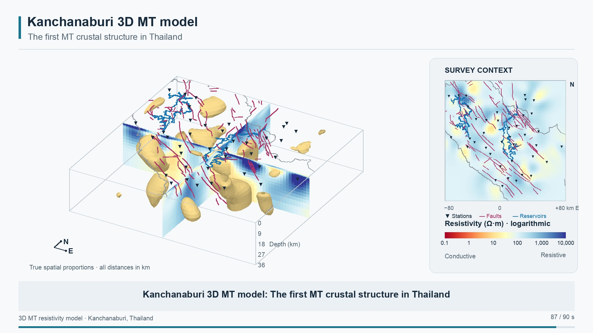

# Kanchanaburi 3D MT model animation

A 90-second animation of the first three-dimensional magnetotelluric (MT) resistivity model of
the crust in Thailand, beneath Kanchanaburi province in the west of the country. The model was
inverted with WSINV3DMT from 39 MT stations; this repository holds the rendered video, the
still frames, the script that produced them, and the settings and validation records.

A companion animation of the Phan / Chiang Rai model is at
[Songkhun/Phan-ChiangRai-3D-MT](https://github.com/Songkhun/Phan-ChiangRai-3D-MT).



## Watch

- **[Kanchanaburi_3D_MT_model.mp4](Kanchanaburi_3D_MT_model.mp4)** · 1920 × 1080, 30 fps, 90 s, H.264, no audio (18.1 MB)

## What the animation shows

| Time | Scene |
|-----:|-------|
| 0–8 s | The survey surface: 39 MT stations across the Kanchanaburi area |
| 8–18 s | Surface context: fault traces, reservoir outlines and the province boundary |
| 18–28 s | The 3D resistivity model opened along two intersecting vertical sections |
| 28–46 s | Descending through the crust: a horizontal slice sweeping from the surface to 36 km |
| 46–62 s | Vertical sections moving east–west, then north–south, through the model |
| 62–76 s | The 10 Ω·m isosurface between 3.5 and 36 km depth: the geometry of the low-resistivity regions |
| 76–85 s | Surface context, cross-sections and isosurface together |
| 85–90 s | Closing frame |

The side panel shows a plan-view map with stations, faults and reservoirs, the position of the
current section, and the logarithmic RdYlBu resistivity scale from 0.1 Ω·m (conductive, warm)
to 10,000 Ω·m (resistive, cool).

## Files

| File | Description |
|------|-------------|
| `Kanchanaburi_3D_MT_model.mp4` | The animation |
| `preview_NNs.jpg` | Sample frames at 4, 14, 24, 38, 50, 58, 70, 81 and 87 s, one per scene |
| `storyboard_preview.jpg` | Contact sheet of the sample frames |
| `verified_closing_frame.jpg` | Last frame extracted from the encoded MP4 for checking |
| `render_kanchanaburi.py` | The rendering script (see below) |
| `render_settings.json` | Model, view, colour and encoding settings written by the script |
| `video_validation.json` | Frame count, duration, resolution and decode check of the MP4 |

## The model

| | |
|--|--|
| Inversion | WSINV3DMT, iteration 1, RMS 2.31 |
| Mesh | 80 × 80 × 37 cells, 348 × 348 × 129 km |
| Viewing window | 160 × 160 km, 0–36 km depth, true spatial proportions |
| Stations | 39 MT sites |
| Resistivity display | 0.1–10,000 Ω·m, logarithmic, RdYlBu |
| Isosurface | 10 Ω·m, 3.5–36 km, VTK cell-to-point averaging in log10 resistivity |

Full values are in `render_settings.json`.

## Rendering

`render_kanchanaburi.py` draws every frame on the CPU with an orthographic projection
(NumPy, Pillow, SciPy, Matplotlib colour maps, PyVista for the isosurface) and pipes raw
frames to FFmpeg via `imageio-ffmpeg`. No OpenGL context is needed, so it runs headless.

It is included as a record of how the video was made rather than as a stand-alone tool. It
depends on files that are **not** in this repository:

- the WSINV3DMT model `kansea4_model.01_01` and response `kansea4_resp.01_01`, read from the
  parent folder;
- the `mtviewer` package (`mtviewer.io.wsinv3dmt`, `mtviewer.render3d.scene`), a desktop
  viewer for 3D MT inversion results, imported from a sibling folder;
- MATLAB files `site3d.mat` (station coordinates, used to cross-check the response file),
  `KANSRIV.mat` (province boundary and reservoir outlines) and `fault_epicenter.mat`
  (fault traces).

With those in place:

```sh
python render_kanchanaburi.py --preview   # settings + still frames only
python render_kanchanaburi.py             # full 2700-frame MP4
```

## Citation

If you use the animation or stills, please cite this repository and the author:

Songkhun Boonchaisuk, Mahidol University Kanchanaburi Campus.
https://github.com/Songkhun/Kanchanaburi-3D-MT

## License

MIT. See [LICENSE](LICENSE).
